<p align="center">
  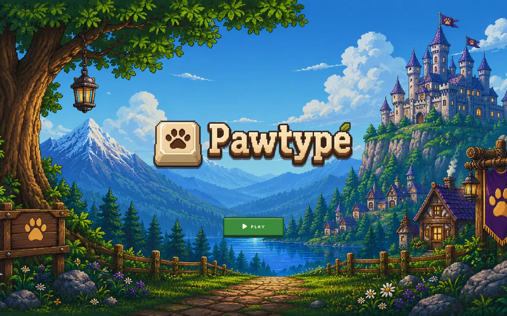
</p>

<h1 align="center">Pawtype Studio</h1>

<p align="center">A cozy typing adventure. Practice in themed rooms, clear lessons and world quests, collect companions and awards, and make a pixel-art camp your own.</p>

<p align="center"><code>TanStack Start</code> &nbsp; <code>React 19</code> &nbsp; <code>Tailwind CSS 4</code> &nbsp; <code>Supabase for accounts and cloud saves</code></p>

<p align="center">
  <a href="#run-locally"></a>
  <br>
  <sub>Want to look around first? Choose <strong>Play</strong> → <strong>Play Demo</strong>. No account or Supabase project is needed for demo mode.</sub>
</p>

<p align="center">
  <a href="#at-a-glance"><strong>At a glance</strong></a> &nbsp;·&nbsp;
  <a href="#the-ui"><strong>The UI</strong></a> &nbsp;·&nbsp;
  <a href="#how-to-play"><strong>How to play</strong></a> &nbsp;·&nbsp;
  <a href="#run-locally"><strong>Run locally</strong></a> &nbsp;·&nbsp;
  <a href="#accounts-and-saves"><strong>Accounts and saves</strong></a> &nbsp;·&nbsp;
  <a href="#explore-the-repository"><strong>Explore the repository</strong></a>
</p>

## At a glance

<table>
  <tr>
    <td align="center" width="25%"><strong>01 · Train</strong><br><sub>Take timed typing tests and review speed, accuracy, and mistakes.</sub></td>
    <td align="center" width="25%"><strong>02 · Learn</strong><br><sub>Follow a guided lesson path with goals and rewards.</sub></td>
    <td align="center" width="25%"><strong>03 · Explore</strong><br><sub>Clear stages across themed world maps.</sub></td>
    <td align="center" width="25%"><strong>04 · Collect</strong><br><sub>Earn coins, raise pets, customize worlds, and browse awards.</sub></td>
  </tr>
</table>

## The UI

These are desktop screenshots of the running app in **Play Demo** mode (mostly 1440 × 900; the Workshop is 1600 × 900). The stats screen shows a completed practice session; other screens show the demo save.

### Camp

The camp is the home hub. Its buildings open the Cabin Bag, Pet Nursery, Blacksmith Workshop, Training Board, Painter’s Tent, Mailbox, and Supply Wagon.

<p align="center">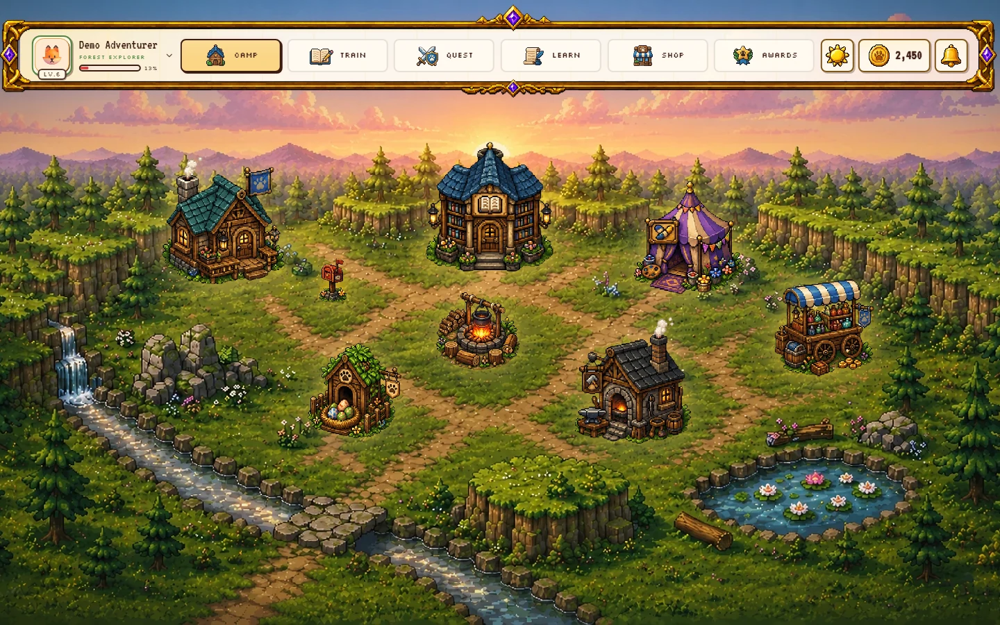</p>

### Practice and adventure

<table>
  <tr><th width="50%">Train · typing practice</th><th width="50%">Quest · adventure map</th></tr>
  <tr>
    <td>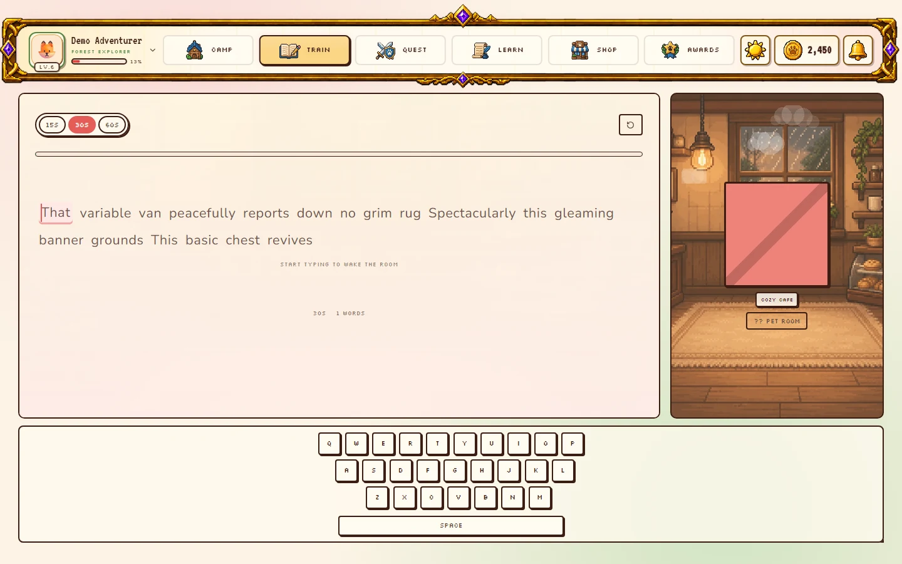</td>
    <td>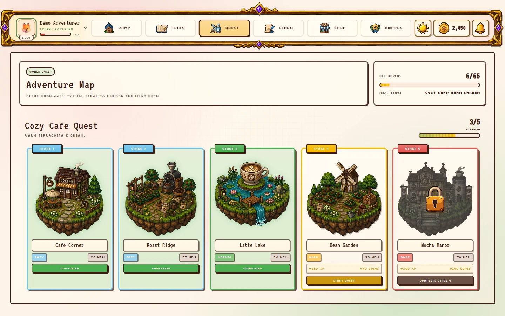</td>
  </tr>
</table>

### Lessons and shop

<table>
  <tr><th width="50%">Learn · lesson path</th><th width="50%">Shop · companions</th></tr>
  <tr>
    <td>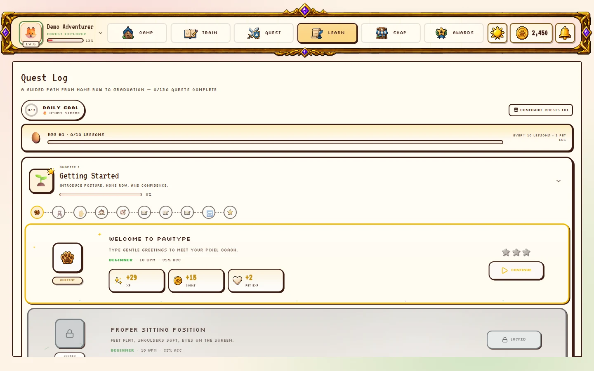</td>
    <td>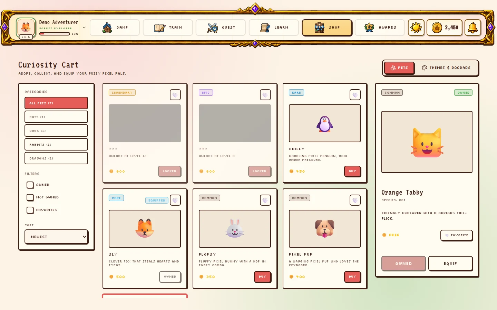</td>
  </tr>
  <tr><th colspan="2">Shop · worlds and decorations</th></tr>
  <tr><td colspan="2" align="center">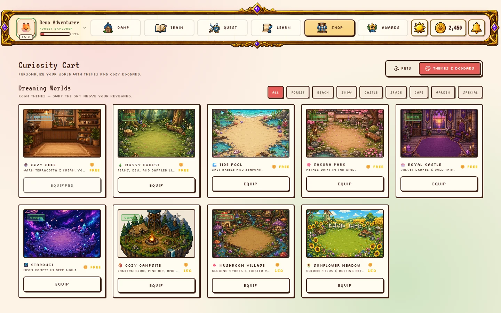</td></tr>
</table>

### Progress and customization

<table>
  <tr><th width="50%">Awards · badge museum</th><th width="50%">Stats · practice history</th></tr>
  <tr>
    <td>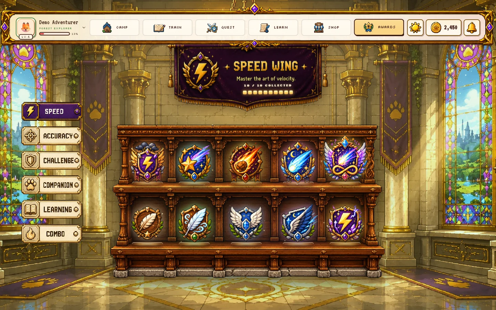</td>
    <td>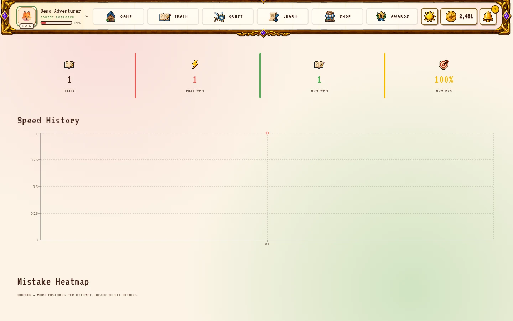</td>
  </tr>
  <tr><th>Settings · worlds and display</th><th>Camp · Blacksmith Workshop</th></tr>
  <tr>
    <td>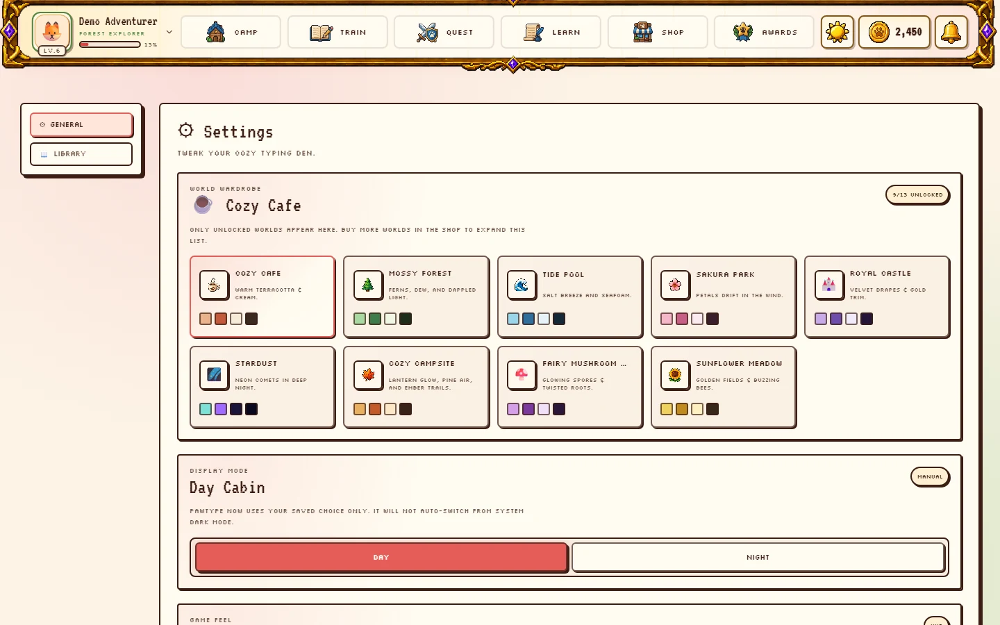</td>
    <td>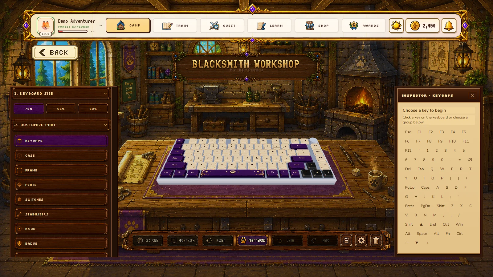</td>
  </tr>
</table>

### Starting screen

<p align="center">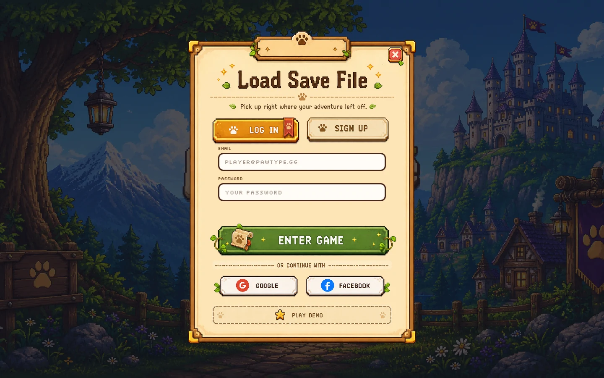</p>

## How to play

1. Select **Play**, then **Play Demo** to enter without an account. The demo starts with a sample player, pets, coins, and some cleared stages.
2. Use the HUD to open **Train**, **Quest**, **Learn**, **Shop**, or **Awards**. Open the profile menu for **Stats** and **Settings**.
3. Finish typing sessions or lessons to track practice and earn in-game progress. Return to Camp to visit its buildings, including the Blacksmith Workshop.

The demo save lives in this browser. An account can sync game state through Supabase when the project is configured.

## Run locally

You need Node.js and npm.

```powershell
npm ci
npm run dev
```

Open the URL Vite prints (normally **http://localhost:8080**), select **Play**, then **Play Demo**. A local demo does not require environment variables or an external editor.

| Command | Purpose |
| --- | --- |
| `npm run dev` | Start the development server |
| `npm run build` | Build the production app |
| `npm run preview` | Preview a local production build |
| `npm run lint` | Run ESLint |

## Accounts and saves

| Mode | Setup | Save behavior |
| --- | --- | --- |
| **Play Demo** | None | Game state is stored in browser local storage. |
| **Signed-in account** | Configure Supabase using [`.env.example`](.env.example) | Authentication and cloud game-state storage use Supabase; the app also keeps a local copy. |

For Google or Facebook sign-in, enable the provider in Supabase and add the callback URL described in [`.env.example`](.env.example). Set both server variables (`SUPABASE_URL`, `SUPABASE_ANON_KEY`) and browser variables (`VITE_SUPABASE_URL`, `VITE_SUPABASE_ANON_KEY`) for account features.

## Explore the repository

| Area | Start here | What it contains |
| --- | --- | --- |
| Routes | [`src/routes/`](src/routes/) | File-based views for Camp, practice, adventure, lessons, shop, awards, stats, settings, and workshop |
| Feature UI | [`src/components/`](src/components/) | Camp, typing, lessons, pets, shop, awards, and shared HUD components |
| Game logic | [`src/lib/game/`](src/lib/game/) | Progress, curriculum, achievements, game state, and typing content |
| Authentication and saves | [`src/lib/auth/`](src/lib/auth/) · [`src/lib/supabase/`](src/lib/supabase/) | Demo mode, account access, and cloud persistence |
| In-app guide | [`src/lib/docs/`](src/lib/docs/) | Documentation shown in Settings → Library |
| Project docs | [`docs/`](docs/) | Camp, achievements, and badge design notes |
